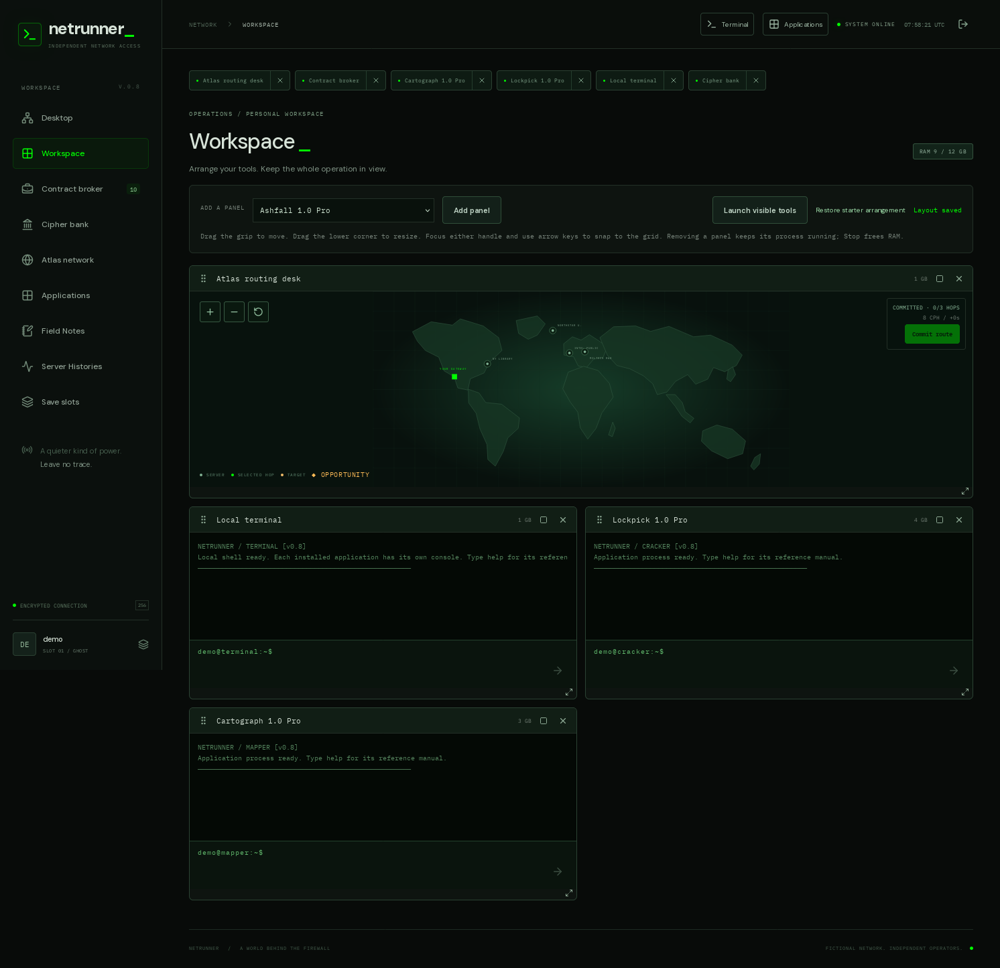
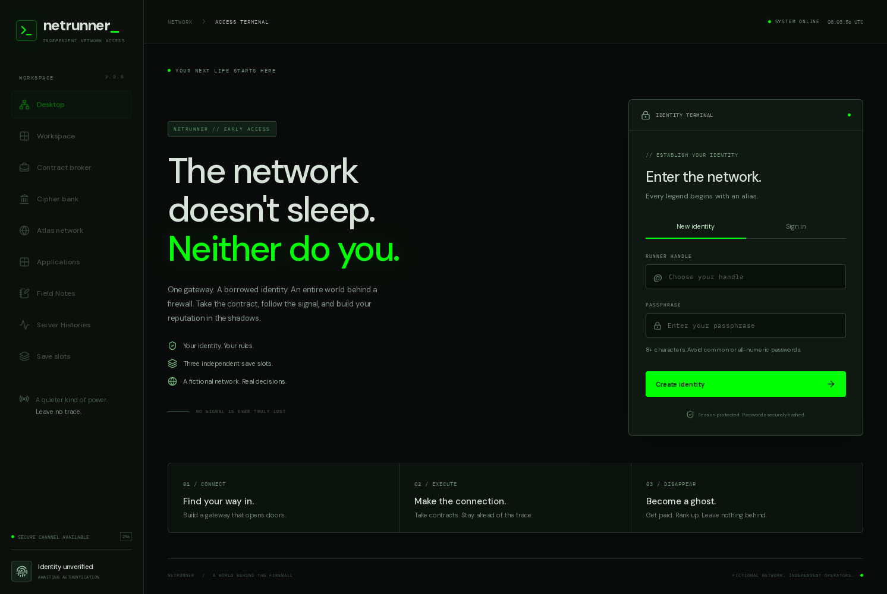
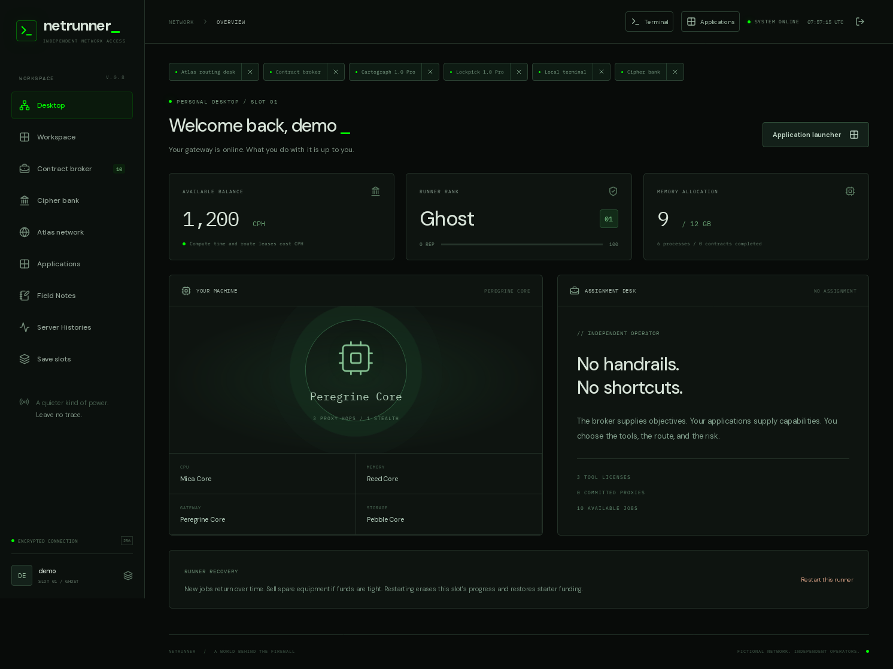
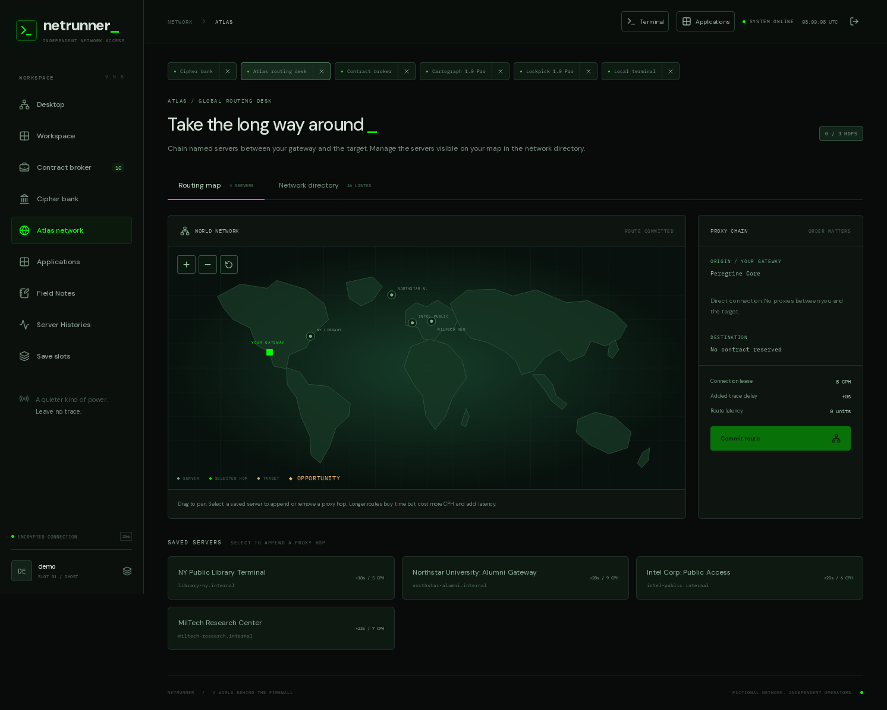
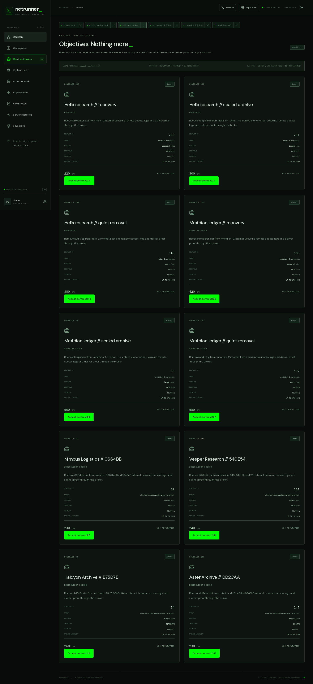
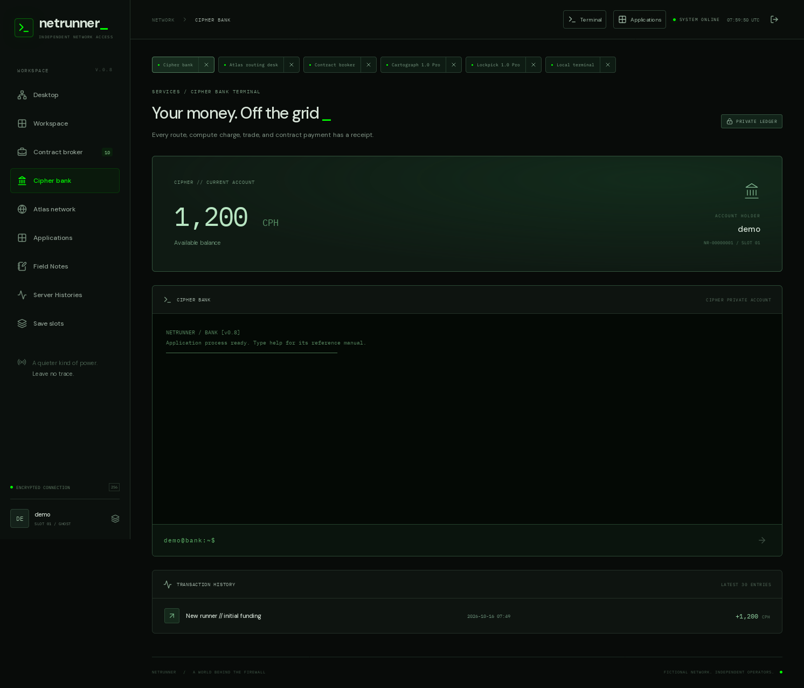
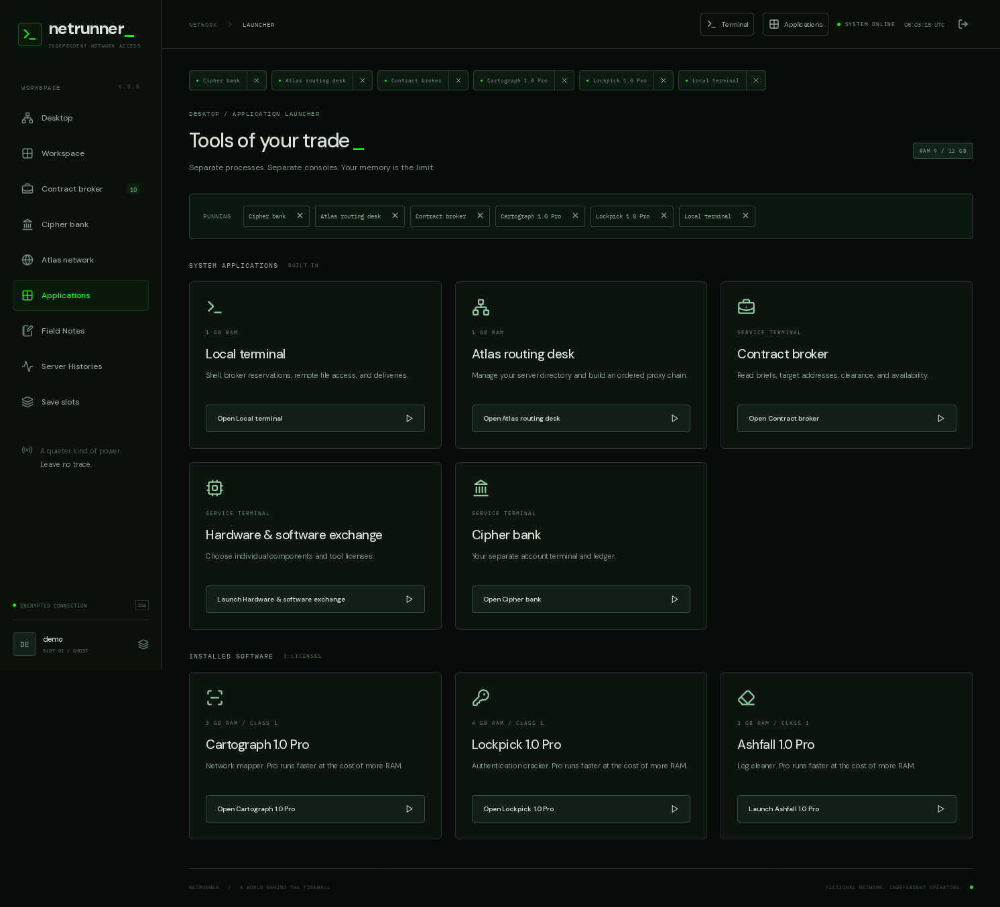
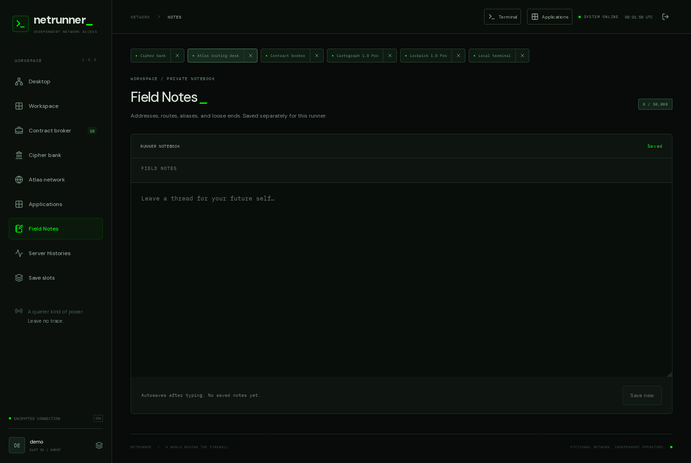

# Netrunner

Netrunner is a browser-based hacker game inspired by Uplink (2001). Build a custom rig, take contracts from an underground broker, and route connections through a network of named servers. A green-on-black terminal drives the action, with owned applets for scanning, cracking, decryption, and log cleanup.

Built with **Python/Django, PostgreSQL, and Vue 3**. All hacking takes place inside a fictional game world.

## Screenshots



<details>
<summary>More screenshots — desktop, Atlas, contracts, bank, applications, and notes</summary>

### Home



### Desktop



### Atlas



### Contract broker



### Cipher bank



### Applications



### Field Notes



</details>

## Quickstart

Install Docker Engine with Compose on Linux, or Docker Desktop on Windows/macOS:

```bash
git clone https://github.com/evanesoteric/netrunner.git
cd netrunner
docker compose up --build
```

Open **http://localhost:5173**, create an account, and initialize a save slot. Each account has three independent saves. Use **Workspace → Launch visible tools** to get started, then reserve a contract through **Contract broker**. Each application's `help` command lists its commands.

Stop with **Ctrl+C**, then `docker compose down`. Start again with `docker compose up`.

**Development database:** changed builds reset accounts and progress by default. To keep saves across builds, create a root `.env` containing `NETRUNNER_RESET_ON_BUILD=0`. Ordinary restarts preserve data. See the [development guide](docs/DEVELOPMENT.md#export-and-import-with-postgresql-tools) for PostgreSQL backups and restores. The Docker setup is intended for local development.

## Core features

- **Manual hacking:** scan targets, crack authentication, retrieve or delete files, clean remote logs, and submit proof for payment.
- **Proxy routing:** discover dozens of public-access proxies and chain named servers on Atlas to buy trace time, balancing connection costs and latency.
- **Custom rigs:** choose hardware and individual software licenses; manage working RAM, local storage, and applet capabilities.
- **Contracts and rank:** rise from Ghost to Architect. Jobs are available at your rank, one above, and one below. Failed contracts carry financial and reputation penalties.
- **IRC Underground:** trade with channel bots for lifetime or single-use exploits matched to exact service fingerprints.
- **Cipher economy:** earn and spend fictional cryptocurrency (CPH), manage a bank account, and trade equipment.
- **Persistent worlds:** each save has its own local files, server state, visit history, notes, and saved workspace arrangement.
- **Hidden discoveries:** uncover the Null Exchange, epic software, backdoors, and ransomware opportunities.

## Pages and tools

| Page | Purpose |
| --- | --- |
| Desktop | View your rig, runner status, and current assignment. |
| Workspace | Arrange the primary terminal, Atlas, and personal panels; layouts save across sessions. |
| Contract broker | Browse, accept, and abort contracts. |
| Cipher bank | Check your balance and transaction history. |
| Atlas network | Discover servers, manage map bookmarks, and build proxy routes. |
| Applications | Open system pages and select owned applet licenses for the primary terminal. |
| IRC Underground | Chat with bot traders, buy fingerprint exploits with CPH, and review your exploit stash. |
| Store | Buy hardware and software; select applet licenses and sell old items. |
| Field Notes | Keep a personal notebook for the current save. |
| Server Histories | Review discovered servers and recorded activity. |
| Save slots | Create, select, or restart one of three independent runners. |
| Null Exchange / Backdoored Servers | Access hidden software and installed backdoor connections once unlocked. |

The terminal is available from the top bar, with Tab completion and integrated `scan <host>` support. `login` opens the **Lockpick** decoder modal. Hacking software runs inside the primary terminal; Atlas keeps its map view. **Logcleaner** clears remote logs directly from the terminal. **Cartograph**, **Rosetta**, and **Tripwire** provide scanning, decryption, and trace monitoring.

## More information

- [Gameplay and command reference](docs/GAMEPLAY.md)
- [Development, database maintenance, and testing](docs/DEVELOPMENT.md)
- [Release notes](docs/RELEASE_NOTES.md)
- [Planned work](TODO.md) and [ideas](IDEAS.md)
